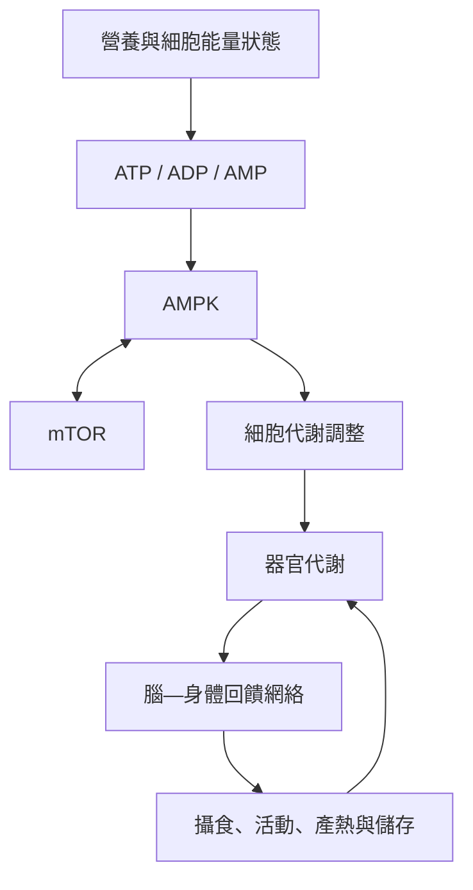

這張地圖整理細胞能量狀態如何與器官及全身能量調節相連。細胞層次以 ATP、AMPK 與 mTOR 為主；器官層次由肝臟、肌肉、脂肪、胰臟和腸道處理營養與儲能；整體層次則透過腦—身體網絡調節攝取、消耗和儲存。

### 核心筆記
* [[能量恆定需要區分細胞與全身兩個尺度]]
* [[能量恆定是一個跨器官的閉環調節系統]]
* [[能量平衡公式成立但不能完整解釋生理調節]]

### 概念連結
* [[能量恆定]]、[[ATP]]、[[AMPK]]、[[mTOR]]、[[下視丘]]、[[脂肪組織]]、[[瘦體素]]、[[總能量消耗]]。
