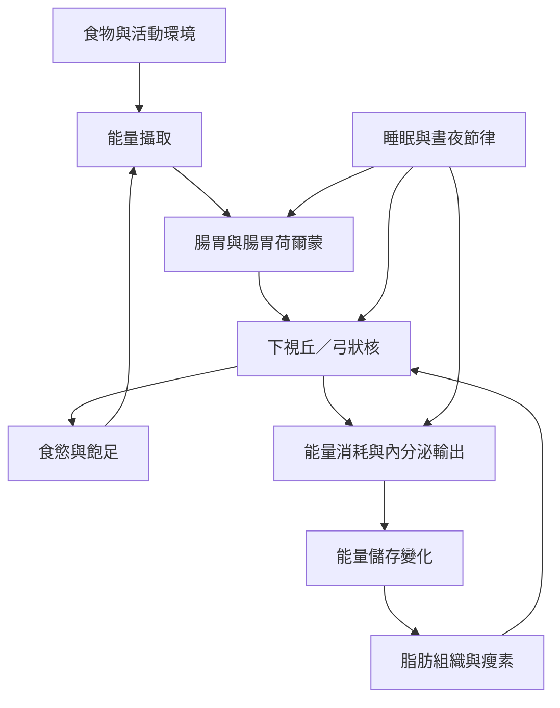

能量恆定的核心不是某一個荷爾蒙或腦區，而是多個生理層次互相回報：脂肪組織與腸道回報儲存及進食狀態，大腦整合訊號後影響食慾、活動、代謝與內分泌；環境則持續改變可取得的食物、活動機會與作息。

閱讀此圖時，可先讀[[能量恆定是調節攝取與支出的動態系統]]，再讀[[下視丘透過多層神經網絡整合身體能量訊號]]、[[脂肪組織是能主動回報與調節能量儲存的內分泌器官]]與[[腸胃荷爾蒙把進食狀態回報給大腦]]。
