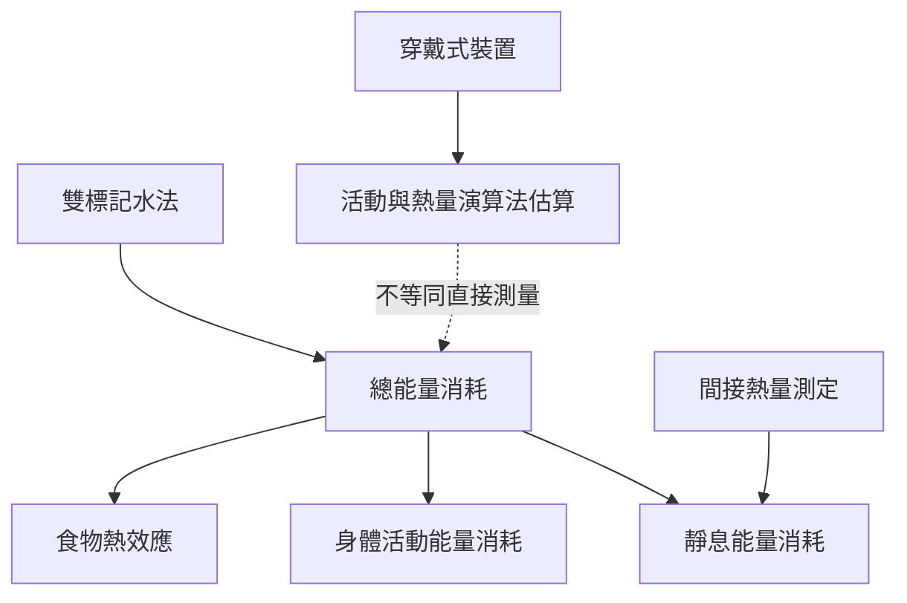

這張地圖把人體能量消耗的組成與測量方法放在一起。不同方法觀察不同時間尺度與環境，因此不能將穿戴裝置估值、活動量和實驗室代謝測量直接互換。

### 核心筆記
* [[能量消耗的測量方法回答不同問題]]
* [[人體總能量消耗可能受到生理補償限制]]
* [[人體能量消耗包含靜息活動與食物熱效應]]

### 概念連結
* [[總能量消耗]]、[[雙標記水法]]、[[能量平衡]]、[[適應性產熱]]。
