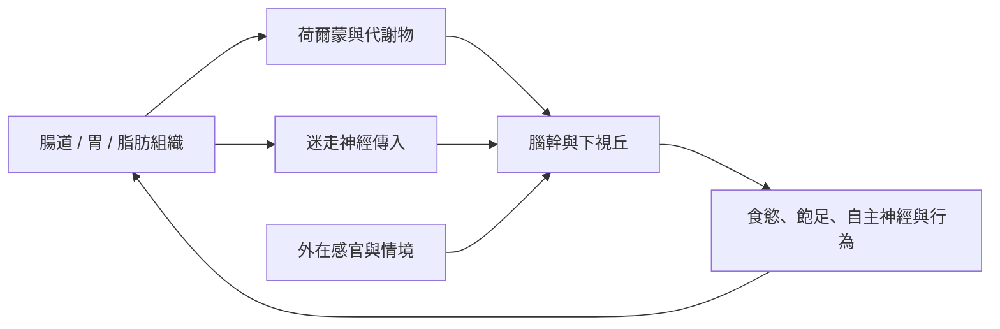

腦腸身體網絡是身體感測、訊號傳遞與行為協調的系統。腸道胜肽、瘦體素及胃飢餓素等訊號，透過血液與迷走神經等路徑影響腦部；內感受則描述身體內部訊號如何被預測、感測與整合成主觀經驗。

### 核心筆記
* [[能量恆定是一個跨器官的閉環調節系統]]
* [[內感受讓能量需求成為可感覺但不必然精確的經驗]]
* [[腦與周邊器官透過神經訊號協調代謝]]

### 概念連結
* [[內感受]]、[[下視丘]]、[[迷走神經]]、[[瘦體素]]、[[胃飢餓素]]、[[腸道胜肽]]、[[飽足]]。
