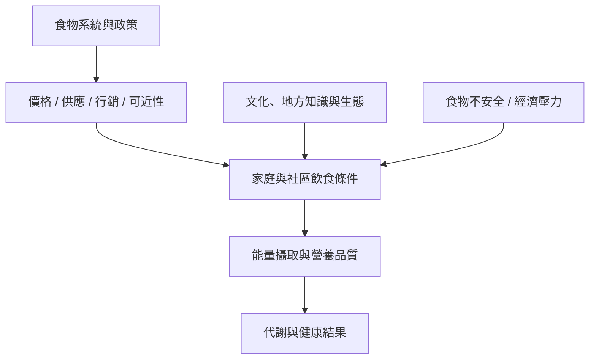

能量恆定發生在具體的食物系統中。價格、供應、土地與文化、行銷、工作時間、交通和公共政策會塑造選擇條件。全球肥胖與食物不安全可以並存，說明健康議題不能只從個體攝取量或體重數字理解。

### 核心筆記
* [[食物環境會形塑個體能量調節的可行選項]]
* [[全球肥胖數據呈現生物社會環境交互作用]]
* [[食物不安全與多種健康風險存在統計關聯]]
* [[全球原住民族與地方社群的食物轉型需結合在地知識]]

### 概念連結
* [[食物環境]]、[[食物不安全]]、[[能量攝取]]、[[能量恆定]]。
