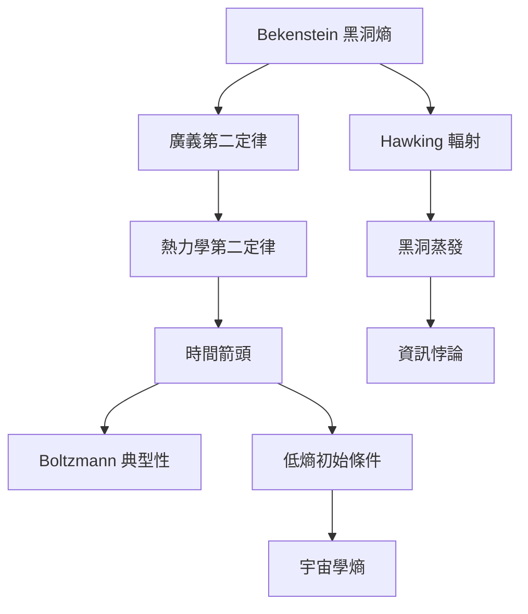

時間箭頭是熵研究中最具哲學與宇宙學意味的問題。宏觀熵增、微觀動力學的時間對稱性、宇宙低熵初始條件與黑洞熱力學分屬不同層次。閱讀時應避免將「熵隨時間增加」當成時間方向問題的完整答案。

## 思與行
* 分別研究宏觀不可逆、宇宙早期條件與黑洞資訊問題。
* 將已確立結果、研究模型與尚未解決的問題使用不同標記。

## 參考
* [[時間箭頭]]、[[低熵初始條件]]、[[宇宙學熵]]、[[黑洞熵]]、[[霍金輻射]]、[[廣義第二定律]]、[[資訊悖論]]。
* [[Ben-Naim 重新檢視熵與時間箭頭的關係]]、[[低熵宇宙初始條件與時間箭頭的爭論]]、[[貝肯斯坦將黑洞視界面積與熵連結]]、[[霍金推導黑洞輻射並確立黑洞熱力學]]。
