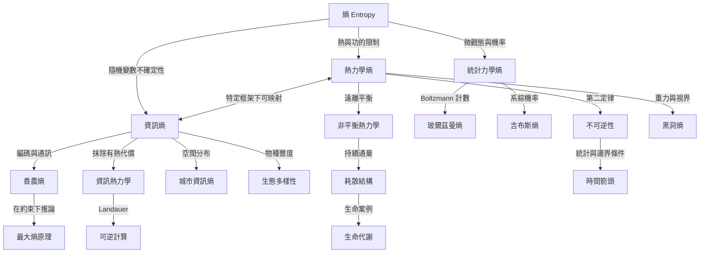

熵是一組跨領域量度與推論工具。核心閱讀順序是先分辨熱力學熵、統計力學熵與資訊熵，再研究它們在生命、計算、生態、城市與宇宙中的應用。連線標籤刻意區分數學關聯、理論推導與應用，避免將相似公式誤當成概念完全相同。

## 思與行
* 先沿著「定義 → 統計基礎 → 資訊理論 → 開放系統 → 跨域應用」閱讀。
* 在跨域引用時，用連線標籤說明是同構、映射、應用還是比喻。

## 參考
* [[熱力學熵與資訊熵有深刻關聯但不能無條件等同]]、[[熵必須先說明系統邊界與描述尺度]]。
* [[熵的物理基礎與統計力學總圖]]、[[資訊理論與計算總圖]]、[[生命、生態與社會系統總圖]]、[[時間、宇宙與黑洞總圖]]、[[熵的量測與模型總圖]]。
