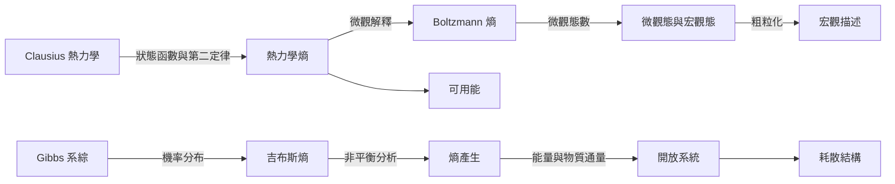

本圖聚焦熵的物理學根源：熱機與第二定律、Boltzmann 微觀態計數、Gibbs 系綜、粗粒化與非平衡熵產生。這條路徑回答「物理系統如何定義熵、為何會出現宏觀不可逆性」。

## 思與行
* 用 Clausius、Boltzmann、Gibbs 三個節點做時間序列閱讀。
* 每一篇物理研究都記錄系統邊界、平衡假設與粗粒化方式。

## 參考
* [[熱力學熵]]、[[熱力學第二定律]]、[[玻爾茲曼熵]]、[[吉布斯熵]]、[[微觀態與宏觀態]]、[[粗粒化]]、[[熵產生]]、[[可用能]]。
* [[克勞修斯建立熱力學熵的歷史脈絡]]、[[玻爾茲曼以機率解釋熵與熱平衡]]、[[吉布斯將統計力學推展為系綜方法]]。
