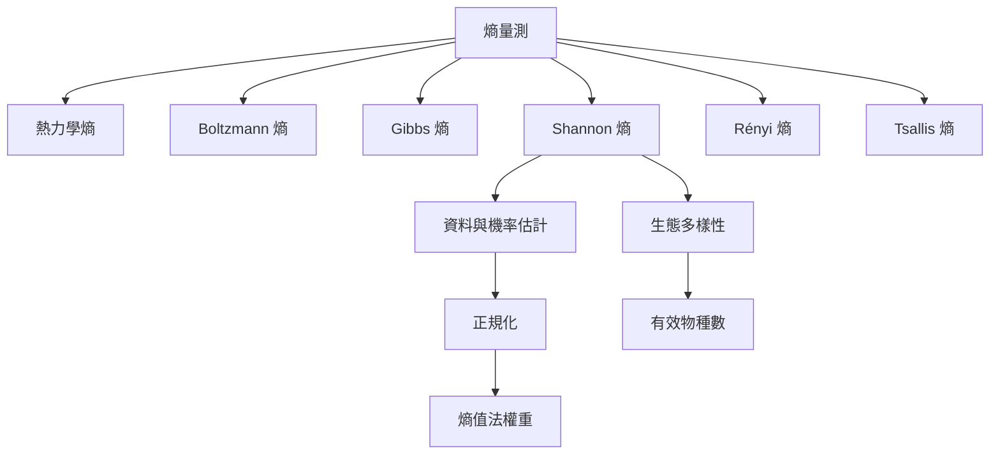

熵值的意義取決於模型輸入與正規化方法。物理熵有熱量、溫度、狀態與微觀自由度；資訊熵有機率分布與對數底數；廣義熵另有參數與公理條件。應先問量測對象，再談數值大小。

## 思與行
* 建立公式索引，包含符號、單位、對數底數、常數與適用條件。
* 應用於評價指標時，將「統計差異」與「規範重要性」分開報告。

## 參考
* [[熱力學熵]]、[[玻爾茲曼熵]]、[[吉布斯熵]]、[[香農熵]]、[[Renyi 熵]]、[[Tsallis 熵]]、[[正規化]]、[[有效物種數]]。
* [[建立一張熵的量測方法對照卡避免錯誤比較]]、[[熵值法的權重反映資料差異而非指標價值]]。
