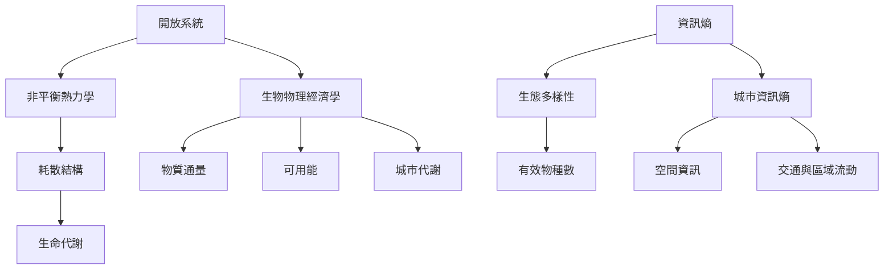

生命、生態與城市都是開放系統，但各領域使用熵的方式不同。生命與非平衡熱力學強調能量物質交換及熵產生；生態學常以 Shannon entropy 描述物種相對豐度；城市研究則可能分析空間分布資訊熵，也可能研究城市代謝。這些方法彼此可對話，卻不能混為同一物理量。

## 思與行
* 以同一城市案例，分別畫出資訊分布圖與物質能量流圖。
* 在生態多樣性研究中，搭配有效物種數與採樣限制。

## 參考
* [[開放系統]]、[[非平衡熱力學]]、[[耗散結構]]、[[生態多樣性]]、[[城市資訊熵]]、[[生物物理經濟學]]、[[物質通量]]。
* [[薛丁格以負熵問題思考生命如何維持組織]]、[[最大熵原理從物理延伸到生態模型]]、[[城市研究顯示熵的物理與資訊應用不可混為一談]]。
