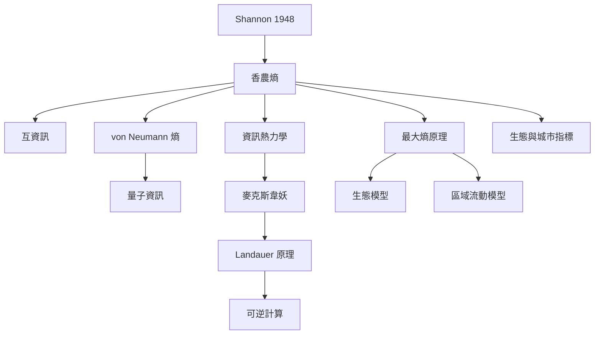

資訊理論中的熵衡量機率不確定性；最大熵原理用於約束下推論；資訊熱力學則把測量、回饋、抹除與能量耗散放進同一物理框架。這一組概念最重要的界線是：資訊熵不等於語意價值，而資訊操作確實可能具有物理代價。

## 思與行
* 從 Shannon 原典開始，再讀 Jaynes、Landauer 與實驗驗證。
* 任何資訊熵應用都記錄樣本空間、機率估計、單位與用途。

## 參考
* [[香農熵]]、[[互資訊]]、[[最大熵原理]]、[[資訊熱力學]]、[[蘭道爾原理]]、[[可逆計算]]、[[von Neumann 熵]]。
* [[香農將熵引入通訊與資訊理論]]、[[傑恩斯以最大熵原理連接資訊論與統計力學]]、[[蘭道爾提出資訊抹除具有熱力學代價]]、[[貝魯等人以單粒子實驗驗證蘭道爾界限]]。
