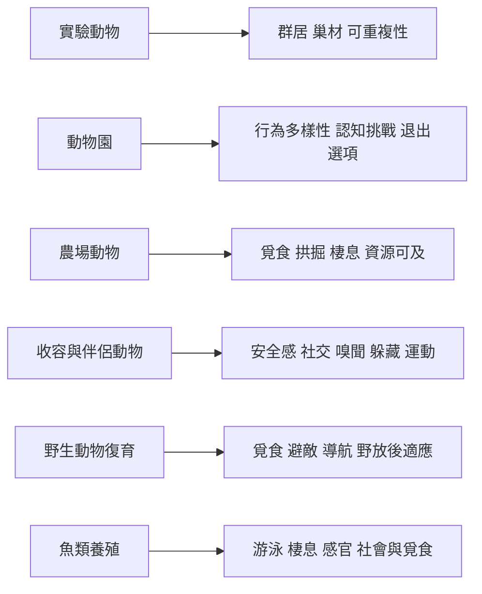

同一個設計原則在實驗室、動物園、農場、收容機構、伴侶動物家庭與野生動物復育中心會有不同形式。跨場域比較可以共享「需求—選項—結果」框架，卻不能複製單一物件或假設。

主要連結：[[note/社會豐富化必須兼顧物種社會性與個體相容性]]、[[note/魚類與其他非哺乳動物需要以自身感官與生態需求設計豐富化]]、[[note/野放前豐富化應訓練自然環境中真正需要的生存技能]]、[[term/結構性豐富化]]、[[term/社會豐富化]]、[[term/飲食豐富化]]、[[term/野放前訓練]]。

場域證據：[[data/齧齒類豐富化可帶來行為與生理效益但須辨認個體與實驗差異]]、[[data/豬隻需要可持續取得且可探索咀嚼與操弄的豐富化材料]]、[[data/蛋雞環境應同時支持棲架休息覓食築巢與沙浴行為]]、[[data/魚類環境豐富化應超越結構物並依養殖系統與物種調整]]、[[data/收容環境中的躲藏箱能幫助貓較快適應陌生環境]]、[[data/野放前行為訓練與環境豐富化可提高部分野生動物移置後存活率]]。
