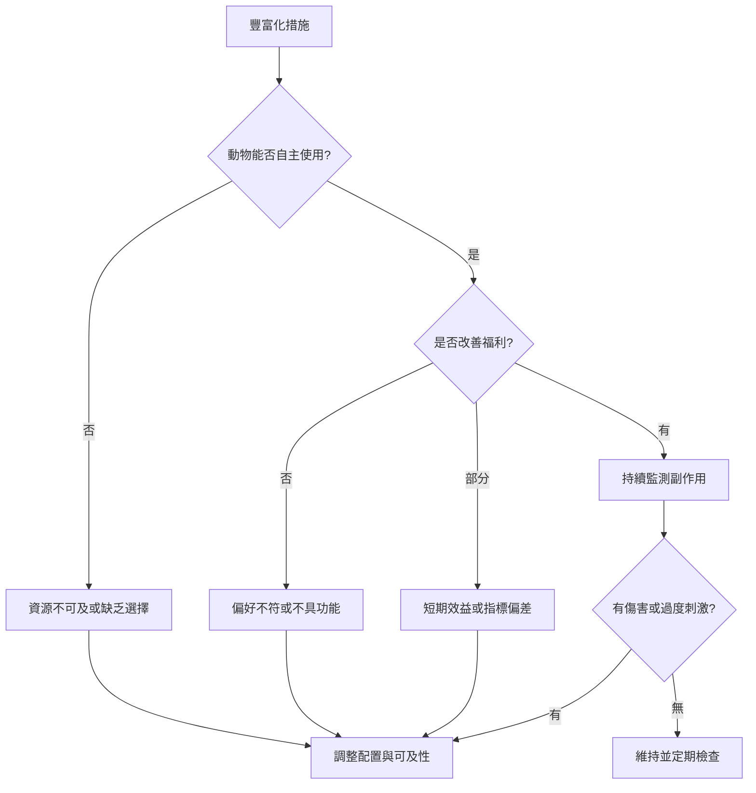

豐富化設計可能因定義模糊、忽略個體差異、刺激過量、資源競爭、材料不安全、只改善短期行為或掩蓋空間不足而失效。檢視失效模式有助避免把好意誤當成福利結果。

主要連結：[[note/真正豐富的環境也必須提供安靜退避與不受干擾的休息空間]]、[[note/環境豐富化不能替代解除造成剝奪的制度性環境限制]]、[[note/適度認知挑戰能增加行動機會但挫折與過載也會傷害福利]]、[[term/材料安全性]]、[[term/挫折]]、[[term/結構性剝奪]]、[[term/個體差異]]。

參考：[[data/齧齒類環境豐富化研究尚未形成一致定義與通用標準]]、[[data/動物園科技豐富化多呈正向或中性結果但證據量與方法仍不足]]、[[data/犬舍豐富化不能忽略群居品質人類互動與過度刺激]]。
