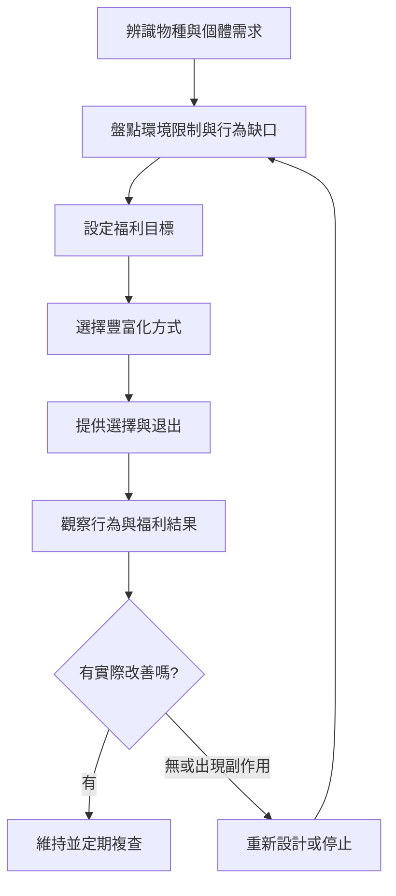

環境豐富化應由物種與個體的行為需求開始，透過結構、感官、社會、飲食與認知等途徑，創造可選擇且可退出的行為機會，再用福利結果持續驗證。核心問題不是「提供了什麼」，而是「動物實際獲得了什麼」。

主要連結：[[note/環境豐富化應從物種行為需求出發而不是從玩具清單出發]]、[[note/環境豐富化必須以動物結果而非物件清單驗證]]、[[note/有效豐富化是一個觀察測試調整再觀察的持續循環]]、[[term/環境豐富化]]、[[term/物種典型行為]]、[[term/行為需求]]、[[term/適應性管理]]。

設計時同時參照 [[data/環境豐富化應以動物生物功能是否改善來定義]]、[[data/五領域模型把環境條件連結到動物可能經驗的正負向心理狀態]] 與 [[data/選擇與控制是動物福利的重要維度但需要精確界定]]。
