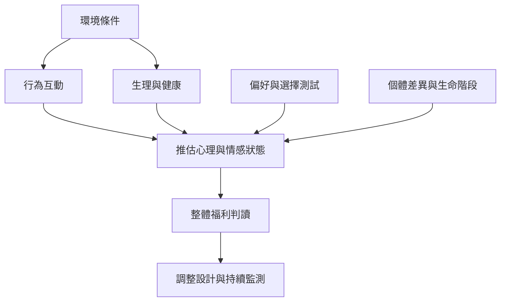

福利評估需要多指標、跨時間與個體化判讀。行為、生理與健康資料彼此補充；單一指標（例如活動量、皮質醇或刻板行為）不足以代表全部福利。正向經驗、能動性與資源可及性也應被納入。

主要連結：[[note/良好福利不只是減少痛苦也需要增加正向經驗]]、[[note/選擇權與控制感使動物從被動接受者成為環境參與者]]、[[note/相同豐富化對不同個體可能產生不同甚至相反的效果]]、[[term/五領域模型]]、[[term/福利結果指標]]、[[term/偏好測試]]、[[term/情感狀態]]。

證據依據：[[data/五領域模型把環境條件連結到動物可能經驗的正負向心理狀態]]、[[data/選擇導向的環境研究多呈正向但仍缺少跨物種量化證據]]、[[data/跨物種魚類統合分析發現豐富化整體提高壓力因應能力但異質性很高]]。
