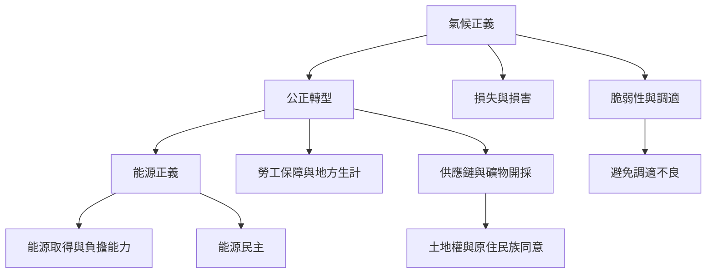

氣候與能源轉型的正義問題同時存在於風險、能源取得、勞動、土地、供應鏈與損失損害。減碳本身不是正義的充分條件；必須檢查新系統是否把成本轉移給其他社群。

概念連結：[[氣候正義]]、[[能源正義]]、[[公正轉型]]、[[能源貧窮]]、[[損失與損害]]、[[環境殖民主義]]。

相關永久筆記：[[氣候脆弱性不是自然條件而是社會關係的結果]]、[[綠色轉型也可能延續殖民式的土地剝奪]]、[[公正轉型必須同時改變產業結構與權力分配]]。
