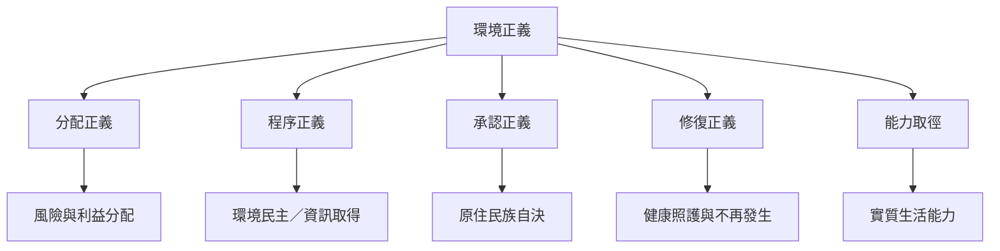

環境正義可用分配、程序、承認、修復與能力等面向共同分析。不同面向並非彼此獨立：不承認某群體的知識，往往也使其難以進入決策；缺乏修復責任，則會讓分配不平等延續。

概念連結：[[環境正義]]、[[分配正義]]、[[程序正義]]、[[承認正義]]、[[修復正義]]、[[能力取徑]]、[[環境民主]]。

相關永久筆記：[[環境正義包含分配程序承認與修復等不同面向]]、[[環境正義不是單純的污染平均分配]]、[[承認正義決定誰能被視為知識與政治主體]]、[[環境修復必須包含補償健康照護與不再發生的保障]]。
