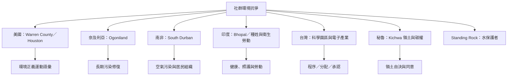

環境正義運動由受影響社群的組織與抗爭推動，並在不同地區與民權、反殖民、原住民族權利、勞動權與社區照護運動交織。個案比較應保留各地制度與歷史差異。

概念連結：[[環境種族主義]]、[[犧牲區]]、[[政治生態學]]、[[環境人權捍衛者]]、[[自由事先且知情同意]]。

相關永久筆記：[[污染設施的空間分布可能反映種族化的權力關係]]、[[環境正義必須從人們維持生活的生態關係出發]]、[[環境正義研究必須避免把社群視為同質整體]]。
