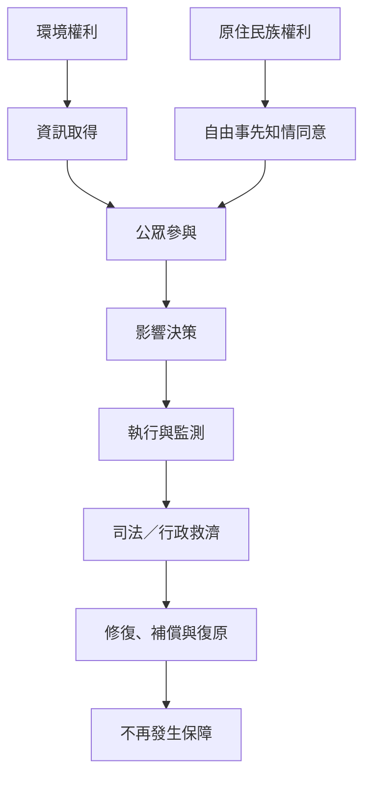

環境正義制度需要使資訊、參與、救濟、權利承認與長期修復連成一套制度鏈。法律存在不代表權利已落實，還需要可近的程序、獨立監測與社群問責。

概念連結：[[環境民主]]、[[環境影響評估]]、[[環境人權]]、[[自由事先且知情同意]]、[[環境人權捍衛者]]。

相關永久筆記：[[環境正義要求受影響者參與整個決策週期]]、[[環境民主讓資訊參與與司法救濟彼此連動]]、[[環境正義需要長期監測而不只是一次性環評]]。
