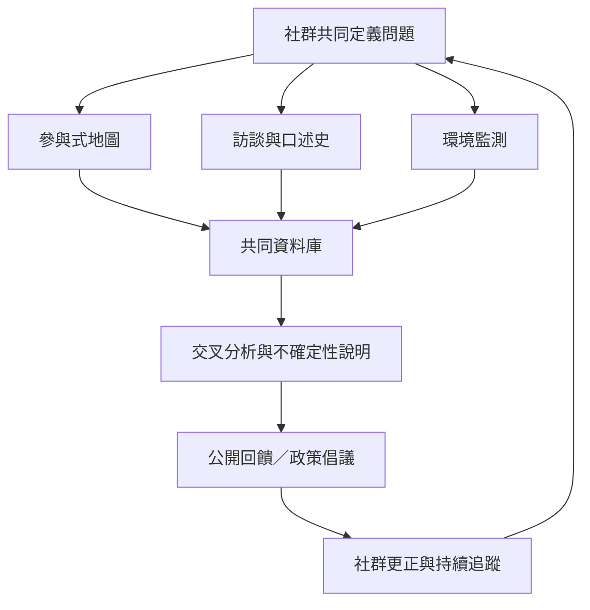

環境正義研究應結合量化監測、地圖、訪談、口述史與社區主導的知識治理。方法選擇必須回應研究問題、資料風險與社群自主，而不是為了製作一張漂亮的地圖或收集更多資料。

概念連結：[[公民科學]]、[[環境健康]]、[[環境影響評估]]、[[交織性]]。

相關永久筆記：[[社區知識與公民科學能補足官方監測的盲點]]、[[環境正義地圖能讓地方衝突形成跨區域知識網絡]]、[[口述史能保存統計資料難以呈現的環境經驗]]。
