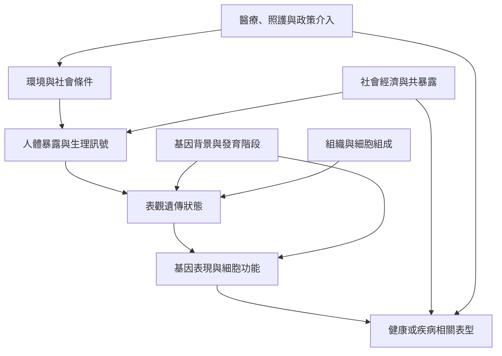

環境暴露可能透過營養、代謝、發炎、荷爾蒙與細胞訊號，與表觀遺傳狀態及後續基因表現產生關聯。暴露時間、劑量、組織、基因背景和社會條件會改變結果；同時必須考慮混雜、反向因果與細胞組成。

圖中的箭頭是研究假說路徑，不表示每個環節都已經被證明。荷蘭饑荒、甘比亞營養、孕期吸菸、孟加拉砷與台灣空污研究，分別提供不同暴露與表觀標記的案例。

**概念連結：** [[表觀遺傳可塑性]]、[[發育起源健康與疾病假說]]、[[表觀遺傳關聯研究]]、[[表觀遺傳時鐘]]、[[代間效應]]。

**案例：** [[荷蘭饑荒世代研究顯示受孕期營養與成年IGF2甲基化差異相關]]、[[甘比亞季節性受孕研究指出母體營養狀態與子代表觀標記相關]]、[[孕期吸菸與新生兒DNA甲基化差異在多個出生隊列中重現]]、[[孟加拉砷污染研究將飲水暴露連結到全基因組DNA甲基化]]、[[台灣研究顯示長期空污與表觀遺傳年齡加速相關]]。

**本書導讀：** [[Epigenetics]]。
