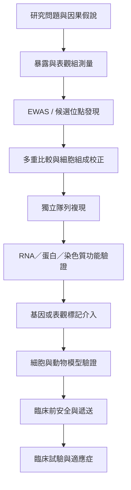

表觀遺傳研究常從全基因組關聯出發，接著檢查獨立複現、細胞組成、基因表現與功能，再透過實驗干預或表觀基因組編輯檢驗因果。若最終走向臨床，仍需證明療效、安全、可遞送性與適用族群。

這條路徑不是每項研究都必須走到臨床，但每往下一層，主張就能更具體。觀察性結果可以是有價值的線索，卻不該被描述成治療已有效或因果已確立。

**概念連結：** [[表觀遺傳關聯研究]]、[[表觀基因組編輯]]、[[DNA甲基化]]、[[表觀遺傳時鐘]]。

**研究方法：** [[EWAS需要獨立複現與細胞組成校正]]、[[表觀遺傳關聯不能單獨證明暴露造成疾病]]、[[表觀基因組編輯能檢驗調控標記是否具有因果作用]]、[[癌症可能涉及異常甲基化但表觀遺傳藥物非萬能]]。

**本書導讀：** [[Epigenetics]]。
