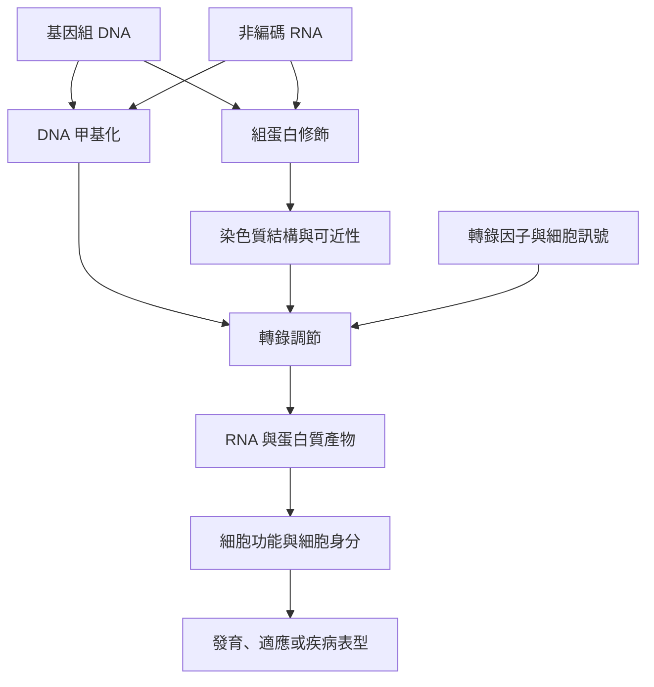

表觀遺傳不是單一化學開關，而是 DNA 修飾、組蛋白、染色質組織、非編碼 RNA 與轉錄因子互相作用的調控網路。其結果會影響基因可近性、轉錄、細胞分化與細胞身分維持。不同標記的意義依位置、細胞類型和時間而變化。

**概念連結：** [[表觀遺傳學]]、[[表觀基因組]]、[[DNA甲基化]]、[[組蛋白修飾]]、[[染色質]]、[[非編碼RNA]]、[[CpG位點]]、[[基因表現]]、[[轉座子]]。

**閱讀依據：** [[表觀遺傳學研究細胞如何在不改變DNA序列下調控基因活動]]、[[表觀遺傳調控是細胞分化得以維持的記憶機制]]、[[DNA甲基化的功能取決於基因組位置與細胞脈絡]]。本書導讀：[[Epigenetics]]。
