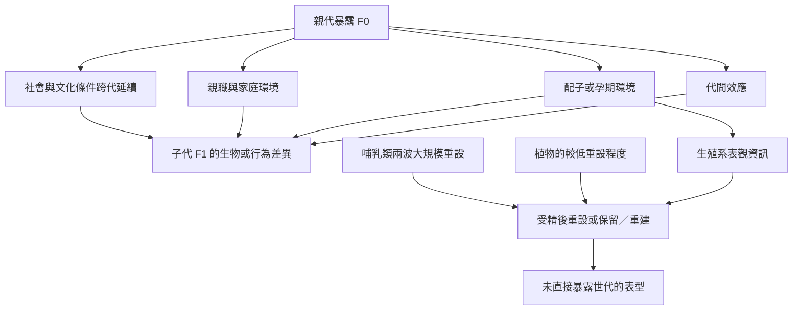

跨世代表觀遺傳的判讀需要先確認物種生殖生物學、直接暴露世代、重設機制與訊號傳遞路徑。人類的代間關聯研究，無法自動證明表觀標記穿越生殖系並在未直接暴露世代維持；植物則因重設模式不同，有較多可追蹤的案例。

要支持真正的跨世代遺傳，需排除孕期直接暴露、親職、持續環境與遺傳序列差異；並在未直接暴露的世代確認相同或可重建的機制及功能結果。 可用以下階梯整理證據強度：①提出可能機制；②觀察到親代與子代關聯；③獨立樣本複現；④排除持續環境與直接暴露；⑤在配子或胚胎中辨識訊號；⑥於未直接暴露世代追蹤；⑦以功能介入確認因果。

**概念連結：** [[代間效應]]、[[跨世代表觀遺傳遺傳]]、[[生殖系重設]]、[[基因組印記]]、[[非編碼RNA]]。

**案例與方法：** [[大屠殺倖存者研究發現FKBP5甲基化代間關聯但未確認傳遞機制]]、[[哺乳類生殖細胞與早期胚胎會大幅重設DNA甲基化]]、[[植物研究提供比哺乳類更扎實的跨世代表觀遺傳案例]]、[[用因果圖拆解「經驗遺傳」主張]]。

**本書導讀：** [[Epigenetics]]。
