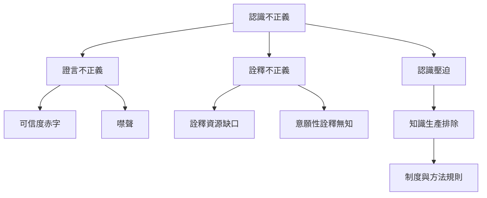

認識不正義的核心問題，是人在知識活動中的平等地位如何受到身分偏見、概念制度與知識排除損害。Fricker 的證言／詮釋雙型態提供起點，Dotson、Pohlhaus 與 Medina 則補充噤聲、認識壓迫、意願性無知與抵抗實踐。

概念連結：[[認識不正義]]、[[證言不正義]]、[[詮釋不正義]]、[[認識壓迫]]、[[認識暴力]]、[[噤聲]]、[[可信度赤字]]、[[詮釋資源]]、[[意願性詮釋無知]]。
