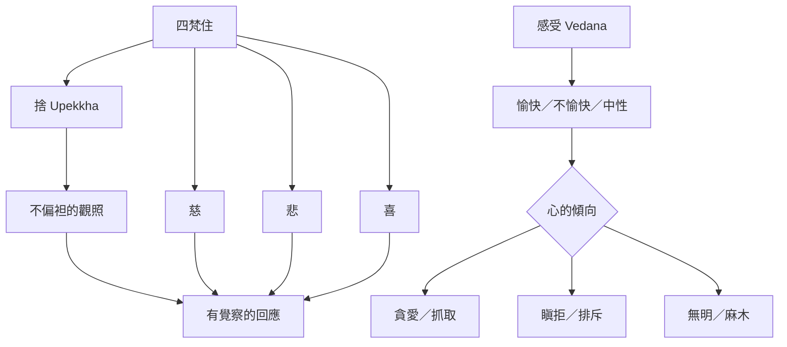

佛教的捨（upekkhā）需要依經典語境理解：它既可能指禪定或心的平衡，也可能指四梵住之一。四梵住把捨放在慈、悲、喜之中，讓不偏袒與不執著不至於變成冷漠。受、貪愛與第二支箭的分析，則說明平等心如何在經驗層面發生。

## 概念連結
* 核心：[[Upekkha（捨）]]、[[四梵住]]、[[受]]、[[貪愛]]。
* 相關品質：[[慈]]、[[悲]]、[[喜]]、[[正念]]、[[非反應性]]。
* 延伸永久筆記：[[四梵住使平等心不致退化成冷漠]]、[[感受可以被如實經驗而不必立刻變成貪愛或瞋拒]]、[[平等心不是對所有情境採取同一種反應]]。

## 參考
* 主要文獻：[[《慈心經》把平等心放在四梵住的慈悲脈絡中]]、[[《箭經》指出平等心不是消除痛感而是不再追加第二支箭]]、[[阿那律陀研究指出佛教的捨有多種功能而非單一情緒]]。
* 實踐延伸：[[用三種感受日記練習在反應之前多留一點空間]]、[[把慈悲與捨設計成一組互相校正的對話練習]]。
* 回到全書：[[Equanimity]]。
