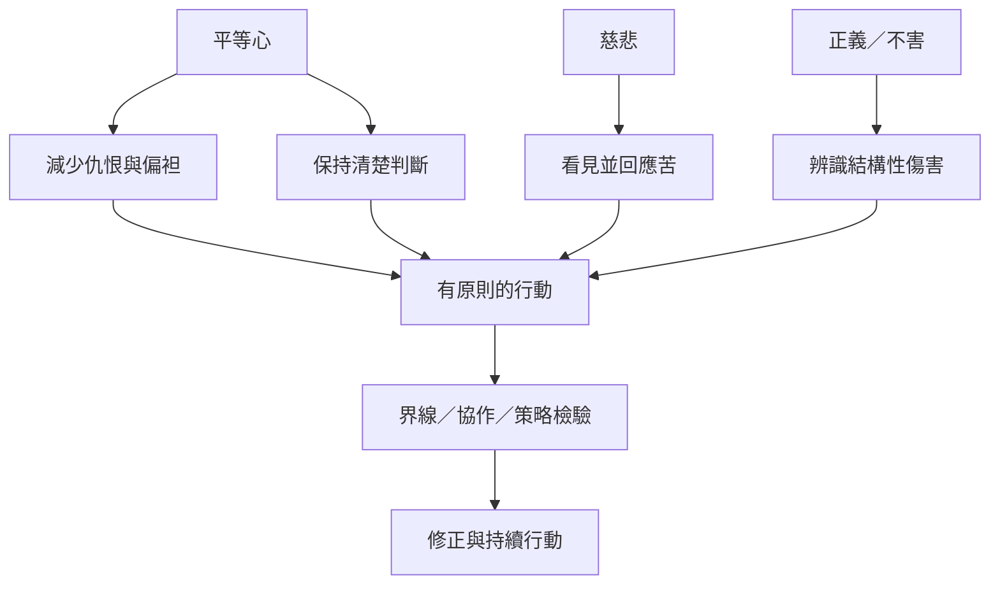

平等心的倫理價值不在於讓人退離世界，而在於減少偏袒與敵意，保留辨別傷害、照顧受影響者並持續行動的能力。慈悲、正義、界線與善巧方便，使平等心能落實到關係和公共生活。

## 概念連結
* 倫理根基：[[慈悲]]、[[不害]]、[[善巧方便]]、[[社會參與佛教]]。
* 實踐面向：[[照顧倫理]]、[[政治極化]]、[[Equanimity（平等心）]]。

## 參考
* 主要文獻：[[芬蘭佛教氣候行動者研究呈現平等心與抗爭如何並存]]、[[當代精神醫療研究把平等心視為需要其他價值補充的臨床能力]]、[[《螺聲經》把捨描述為遍滿世界且不懷敵意的心]]。
* 永久筆記：[[平等心可以支持而非削弱公共行動]]、[[平等心需要由慈悲與正義感補足]]、[[照顧工作中的平等心必須和責任界線一起培養]]。
* 回到全書：[[Equanimity]]。
