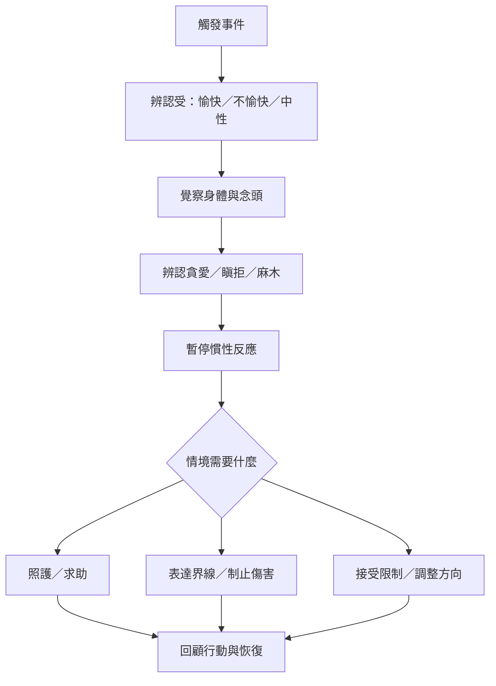

日常訓練不應以製造固定的平靜感為目標，而是練習看見感受、理解慣性、辨認可控與不可控，並選擇更合宜的行動。練習需要持續反思，也需要在身體安全與心理承受範圍內進行。

## 概念連結
* 內在歷程：[[受]]、[[正念]]、[[貪愛]]、[[非反應性]]、[[經驗接納]]。
* 行動選擇：[[結果不由我全然控制但行動仍由我負責]]、[[平等心不是對所有情境採取同一種反應]]。

## 參考
* 靈感筆記：[[用三種感受日記練習在反應之前多留一點空間]]、[[以第二支箭檢查日常痛苦中哪些部分可以停止追加]]、[[用可控與不可控雙欄表把平等心帶進工作]]、[[把平等心日記加入情緒強度與恢復時間而非只記是否平靜]]。
* 研究來源：[[《箭經》指出平等心不是消除痛感而是不再追加第二支箭]]、[[Equanimity Scale-16把平等心拆成經驗接納與非反應性]]。
* 回到全書：[[Equanimity]]。
