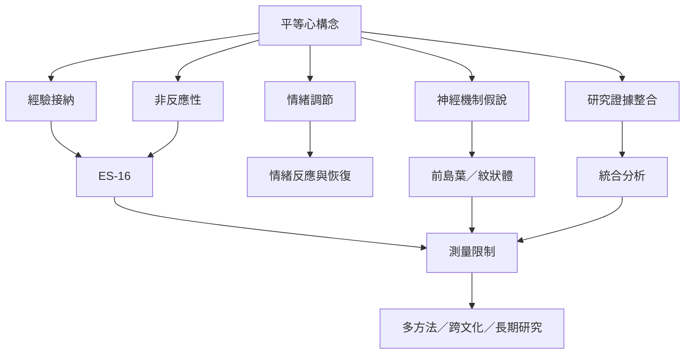

當代研究試圖把平等心拆成可觀察的心理成分，例如經驗接納、非反應性、情緒反應的持續時間與恢復速度。量表、神經科學和統合分析各自回答不同問題，也有不同限制。

## 概念連結
* 核心：[[Equanimity（平等心）]]、[[正念]]、[[情緒調節]]。
* 心理構念：[[經驗接納]]、[[非反應性]]、[[心理測量]]。
* 神經研究：[[前島葉]]、[[紋狀體]]、[[預測誤差]]。

## 參考
* 主要文獻：[[正念研究者主張應把平等心從正念中辨識出來]]、[[Equanimity Scale-16把平等心拆成經驗接納與非反應性]]、[[日本神經科學綜述提出平等心可能削弱感受與欲求的自動連結]]、[[2025年統合分析發現正念策略對情緒反應有小幅效果但研究異質性高]]。
* 永久筆記：[[覺察與平等心是相互支持但可區分的能力]]、[[平等心的測量只能捕捉構念的一部分]]、[[平靜不應以情緒麻木作為唯一指標]]。
* 回到全書：[[Equanimity]]。
