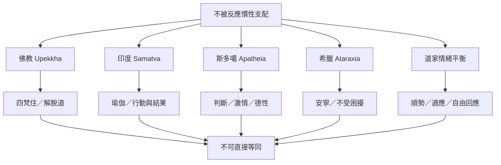

不同文化傳統都曾思考如何不被情緒與外在變化支配，但它們對理想狀態的理解並不相同。比較應先辨認各自的倫理與形上學脈絡，再討論共同問題。

## 概念連結
* 佛教與印度：[[Upekkha（捨）]]、[[Samatva（平等）]]、[[Vairagya（離欲）]]。
* 古希臘：[[Apatheia（不受激情支配）]]、[[Ataraxia（心靈安寧）]]、[[Eupatheiai（良好情感）]]。
* 道家：[[心齋]]、[[坐忘]]、[[莊子]]。

## 參考
* 主要文獻：[[東西方寧靜研究顯示相似詞彙背後有不同哲學目的]]、[[斯多噶哲學的不受激情支配不是變成沒有感情的人]]、[[《薄伽梵歌》第二章第四十八偈把平等心放在行動與結果之間]]、[[道家莊子研究把平靜理解為能隨情境調整的自由回應]]。
* 永久筆記：[[跨文化比較應先保留概念差異再尋找共通問題]]、[[道家的平靜重視順勢而變而非僵硬不動]]。
* 回到全書：[[Equanimity]]。
