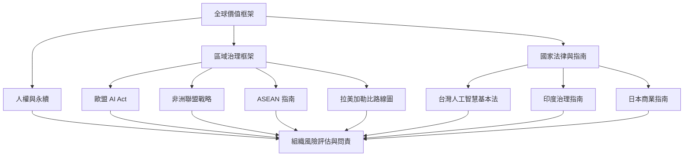

人工智慧倫理的規範治理由全球價值框架、區域原則、國家法律與組織程序交織而成。UNESCO 與 OECD 提供共同語言；歐盟 AI Act 與歐洲理事會公約展示不同法律路徑；非洲聯盟、ASEAN、印度、拉丁美洲與台灣則反映區域發展條件。閱讀時要區分法律、條約、政府建議與自願框架的拘束力。

概念連結：[[人工智慧倫理]]、[[風險分級治理]]、[[人權導向設計]]、[[可問責性]]、[[民主治理]]。

研究連結：[[全球人工智慧倫理應以人權尊嚴多元共融與生態福祉作為共同底線]]、[[歐盟人工智慧法以風險分級配置義務而非一體適用]]、[[台灣人工智慧基本法建立人本創新與權利保障的基礎法律架構]]、[[非洲聯盟以非洲自主發展與區域合作制定人工智慧大陸戰略]]、[[ASEAN生成式人工智慧指南回應東南亞社會與產業脈絡]]。
