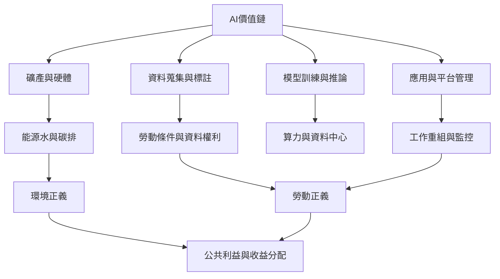

AI 的物質基礎包括礦產、晶片、能源、資料中心與水資源；人力基礎則包括資料標註、內容審查、測試與維運。環境和勞動成本往往由不同地區承擔，卻未必分享決策與收益。

概念連結：[[AI勞動]]、[[資料標註]]、[[資料殖民主義]]、[[算力]]、[[AI永續]]、[[環境正義]]、[[生命週期評估]]。

研究連結：[[Ghost Work揭露AI服務背後仰賴低可見度的人類勞動]]、[[Atlas of AI把人工智慧放回礦產勞動資料與地球政治之中]]、[[AI伺服器環境研究顯示水資源與碳排應納入部署決策]]、[[ILO研究指出生成式AI更可能轉變多數工作而非直接消滅所有職位]]。
