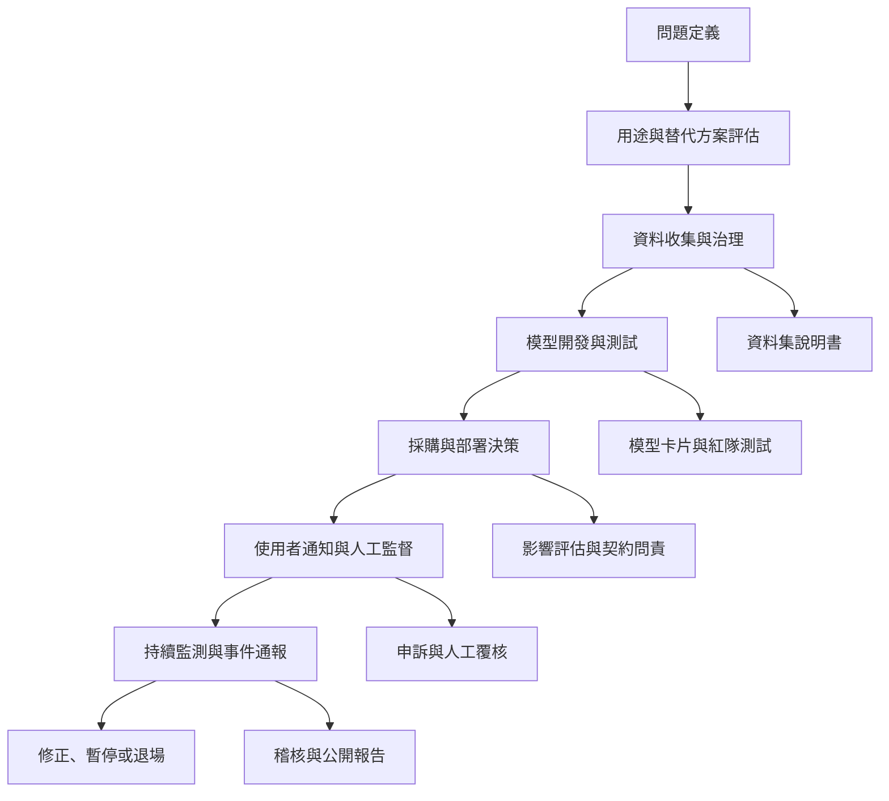

AI 風險治理應隨生命週期持續進行，而不是部署前做一次形式檢查。每一階段都需要清楚的責任人、可檢查文件、受影響者參與與可停止條件。

概念連結：[[風險評估]]、[[影響評估]]、[[人類監督]]、[[模型卡片]]、[[資料集說明書]]、[[申訴權]]、[[可稽核性]]。

研究連結：[[NIST生成式人工智慧風險框架把可信賴特性轉化為組織流程]]、[[資料集說明書讓資料來源用途與限制成為可追溯文件]]、[[模型卡片要求揭露AI模型的適用情境與群體表現限制]]、[[加拿大自動化決策指令把政府透明度影響評估與救濟連在一起]]。
