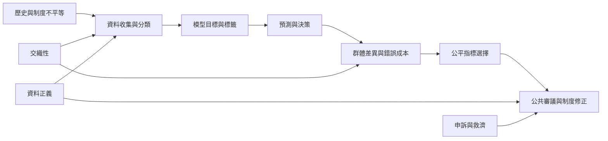

AI 公平不是只處理模型準確率，而是從資料如何生成、分類目標如何設定、錯誤成本由誰承擔，一路追問到制度本身是否正當。交織性分析能看見不同權力關係如何共同塑造群體風險。

概念連結：[[演算法公平]]、[[交織性]]、[[資料正義]]、[[自動化偏見]]、[[自動化不平等]]、[[公共利益]]。

研究連結：[[Gender Shades研究證明人臉分類錯誤會沿種族與性別交織分布]]、[[演算法公平研究指出公平定義包含不可迴避的價值選擇]]、[[種族科技論指出自動化可能用中立外觀延續既有種族階序]]、[[福利自動化可能把貧困者轉化為風險分數與監控對象]]。
