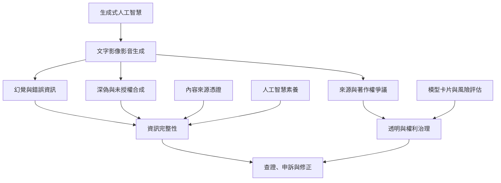

生成式 AI 的輸出可能有用，但也可能出現幻覺、偏誤、深偽與來源混淆。可信度治理需要結合使用者素養、內容來源線索、模型文件、查證流程與平台責任。

概念連結：[[生成式人工智慧]]、[[基礎模型]]、[[幻覺]]、[[深偽]]、[[內容來源憑證]]、[[資訊完整性]]、[[人工智慧素養]]。

研究連結：[[隨機鸚鵡研究提醒大型語言模型的規模擴張伴隨環境與社會成本]]、[[NIST生成式人工智慧風險框架把可信賴特性轉化為組織流程]]、[[聯合國2026年科學小組報告要求全球AI治理建立共同證據基礎]]。
