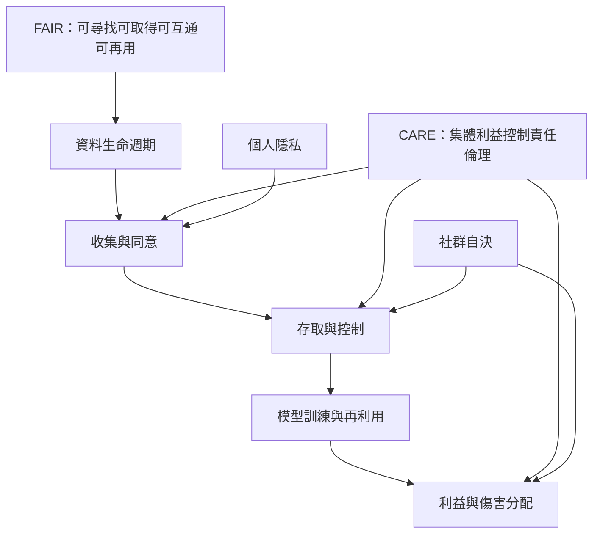

AI 資料治理不只是取得足夠資料，還包括資料來源、目的、同意、控制權、社群利益與二次使用規則。FAIR 強調資料可用性，CARE 則提醒資料可用性不能凌駕於原住民族權利與集體自決。

概念連結：[[資料正義]]、[[資料殖民主義]]、[[原住民族資料主權]]、[[CARE原則]]、[[FAIR原則]]、[[開放資料]]、[[隱私保護]]。

研究連結：[[CARE原則要求原住民族資料治理以集體利益自主控制與倫理為核心]]、[[資料集說明書讓資料來源用途與限制成為可追溯文件]]、[[資料女性主義將資料科學重新放回權力與社會不平等脈絡]]。
