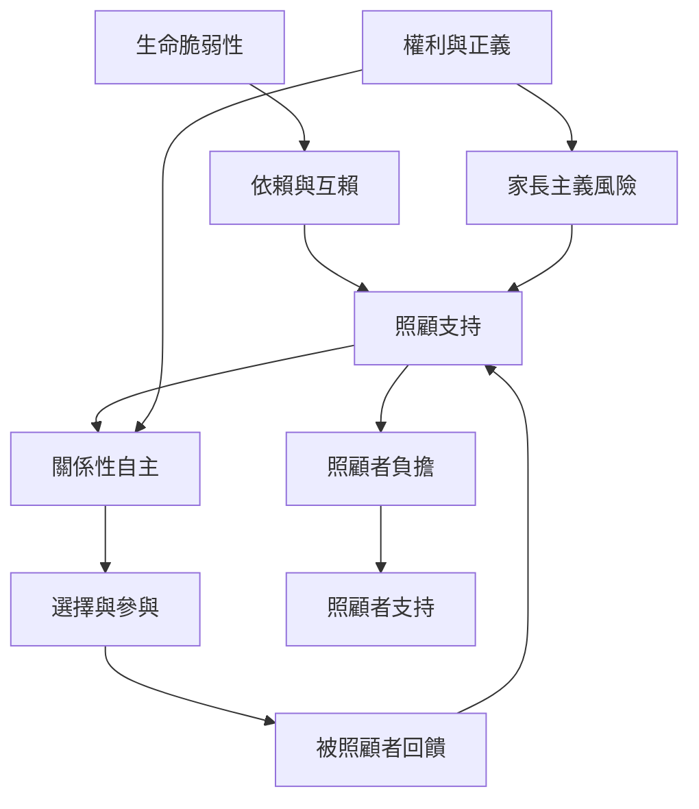

這張地圖將依賴、脆弱性、自主與照顧支持連接起來。核心不是把依賴者當成被動受助者，而是辨認自主如何由可取得的資源、溝通支持與關係共同促成；同時避免照顧以善意為名變成控制。

**概念連結：** [[人類的依賴性是普遍處境而非個人失敗]]、[[自主必須建立在可取得的關係性支持之上]]、[[照顧倫理不能以善意取代被照顧者的自主]]、[[照顧者也需要照顧與制度支持]]、[[脆弱性]]、[[依賴]]、[[關係性自主]]

**全書導讀：** [[Ethics_of_care]]

**核心論點：** [[照顧倫理是一套關係性而非單純情緒性的規範倫理]]、[[照顧與正義必須互相校正]]、[[照顧倫理必須追問照顧工作的權力分配]]
