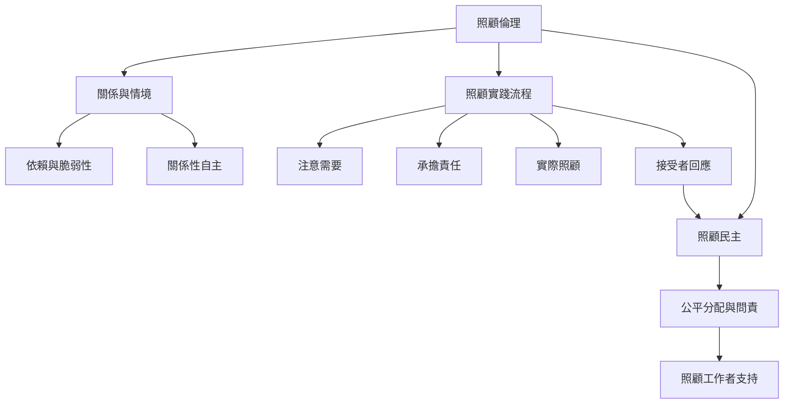

這張概念地圖串連照顧倫理的道德起點、實踐流程與政治擴展：從關係中的需求與回應，走向照顧責任如何被制度分配。它提醒閱讀者不要把照顧縮小成私人美德，也不要把政治制度從日常照顧勞動中抽離。

**概念連結：** [[照顧倫理]]、[[照顧的五個階段讓責任與品質可以被檢視]]、[[民主制度應使照顧責任可見且共同承擔]]、[[照顧與正義必須互相校正]]、[[注意性]]、[[責任]]、[[勝任能力]]、[[回應性]]

**全書導讀：** [[Ethics_of_care]]

**核心論點：** [[照顧倫理是一套關係性而非單純情緒性的規範倫理]]、[[照顧與正義必須互相校正]]、[[照顧倫理必須追問照顧工作的權力分配]]
