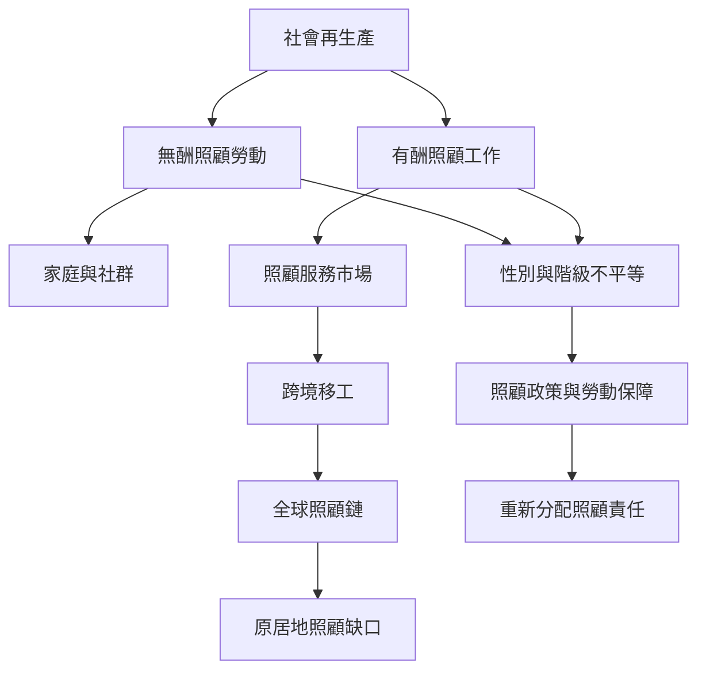

這張地圖聚焦照顧工作如何支撐社會生活，又如何透過家庭、市場、國家與跨國移動被不平等分配。分析焦點包括無酬勞動、照顧服務、移工權利、政策投資與照顧者支持。

**概念連結：** [[照顧勞動是社會再生產不可缺少的基礎]]、[[全球照顧鏈把照顧成本跨國轉移]]、[[照顧制度必須同時改善工作條件與服務可近性]]、[[交織性分析能揭露照顧負擔如何沿權力軸線分配]]、[[照顧者支持]]

**全書導讀：** [[Ethics_of_care]]

**核心論點：** [[照顧倫理是一套關係性而非單純情緒性的規範倫理]]、[[照顧與正義必須互相校正]]、[[照顧倫理必須追問照顧工作的權力分配]]
