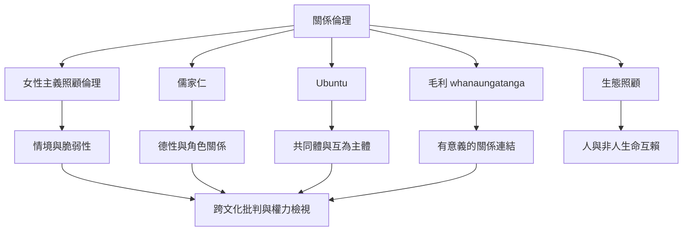

這張地圖比較女性主義照顧倫理與不同文化的關係倫理，同時把照顧延伸至非人生命。比較時應保留概念的在地脈絡：仁、Ubuntu 與 whanaungatanga 可互相對話，卻不可被直接等同。

**概念連結：** [[跨文化照顧必須尊重不同的關係世界觀]]、[[仁與照顧倫理有交集但不能互相化約]]、[[whanaungatanga把照顧理解為持續建立有意義的關係]]、[[Ubuntu的共同體倫理也必須容納衝突與反抗]]、[[照顧倫理可以延伸到非人生命與生態系統]]

**全書導讀：** [[Ethics_of_care]]

**核心論點：** [[照顧倫理是一套關係性而非單純情緒性的規範倫理]]、[[照顧與正義必須互相校正]]、[[照顧倫理必須追問照顧工作的權力分配]]
