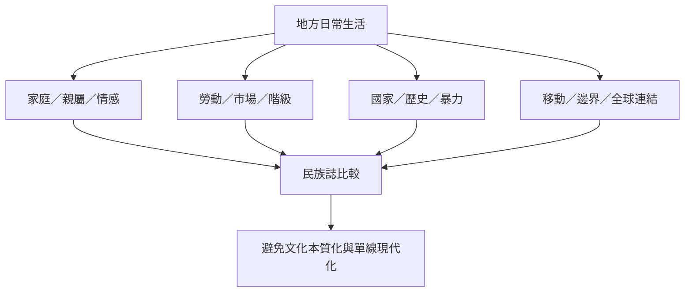

不同地區的民族誌顯示，地方生活不是全球制度的被動結果。埃及貝都因詩歌讓情感與道德秩序顯現；馬來西亞工廠女工的身體經驗揭示工業化與性別；印度案例呈現暴力如何沉入日常；印尼與尚比亞案例挑戰中心／邊陲及現代化的單線敘事；紐約、墨西哥與日本案例則展示城市、勞動、家庭與移動如何被歷史塑造。

**閱讀重點**：案例不是用來替某個國家貼上固定文化標籤，而是展示不同研究問題、歷史時期與研究者位置如何產生不同知識。比較時必須交代時間、地點、群體與材料限制。

## 核心案例
* 埃及：[[埃及貝都因詩歌顯示情感表達同時參與道德秩序與權力關係]]。
* 馬來西亞：[[馬來西亞工廠女工的身體經驗揭示資本主義紀律與地方文化的交會]]。
* 印度：[[印度暴力的後果在日常關係與生活修補中持續存在]]。
* 印尼：[[印尼達雅克社群的民族誌挑戰把邊陲地方視為封閉他者]]。
* 尚比亞：[[尚比亞銅礦城鎮的衰退經驗修正單線現代化敘事]]。
* 美國、墨西哥、日本與台灣：[[紐約東哈林區的街頭經濟顯示貧窮與尊嚴如何交織]]、[[墨西哥街頭販售者的生命故事讓民族誌關係本身成為研究主題]]、[[日本東京郊區家庭生活可以連結戰後階級與現代化變遷]]、[[台灣原住民族研究倫理需要將族群同意視為集體自決的一環]]。

## 延伸行動
* [[以地方比較研究檢驗現代化敘事是否具有單一路徑]]
* [[追蹤一件物品如何穿越家庭市場與制度以建立多點田野]]
