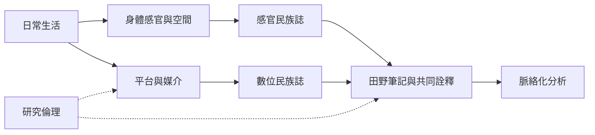

數位民族誌與感官民族誌都挑戰只依賴面對面訪談及視覺觀察的研究模式。前者將平台規則、媒介基礎設施與線上／線下互動納入分析；後者把聲音、氣味、觸覺、身體動作與空間感知當作知識材料。兩者都要求研究者說明資料是如何被感知、擷取與轉譯的。

**閱讀重點**：線上資料不是天然公開，身體感官也不是研究者可以直接外推的普遍經驗。研究設計應辨識平台可見性、身體差異與資料缺席，並決定是否需要跨場域觀察。

## 核心概念
* [[Digital_ethnography]]、[[Netnography]]、[[Sensory_ethnography]]、[[Fieldnotes]]、[[Informed_consent]]。
* [[數位場域同時由使用者互動與平台規則構成]]、[[線上可見不代表研究者可以不經思考地引用]]、[[身體感官也是社會知識的生成途徑]]。

## 延伸行動
* [[以感官步行記錄城市如何被不同身體經驗]]
* [[將一個線上社群的資料可見性與隱私期待繪成地圖]]
