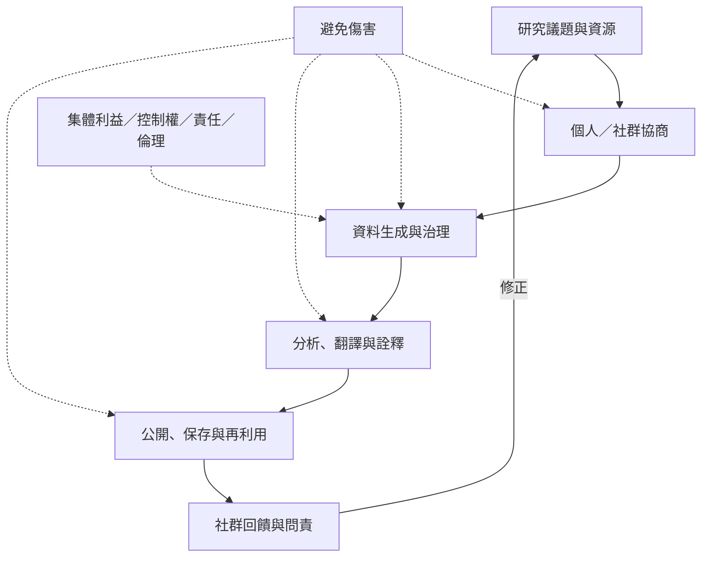

民族誌倫理超越研究者與單一受訪者之間的同意程序。它關係到研究問題由誰提出、資料由誰控制、社群如何被代表、成果如何流通，以及研究是否造成傷害或增加集體福祉。去殖民與原住民族資料主權方法提醒研究者：研究成果不是研究者可以無條件占有的資產。

**閱讀重點**：CARE 原則、臺灣人類學與民族學學會倫理規範、AAA 專業責任原則各有制度脈絡，不可互相取代。研究者應依場域法律、機構規範與社群治理安排進行具體協商。

## 核心概念
* [[Informed_consent]]、[[Decolonizing_methodologies]]、[[Indigenous_data_sovereignty]]、[[CARE_principles]]、[[Collaborative_ethnography]]。
* [[研究倫理是持續協商的關係實踐]]、[[去殖民研究要改變知識生產的控制權與受益關係]]、[[原住民族資料主權要求社群參與資料治理]]。

## 延伸行動
* [[把知情同意拆成不同階段的可撤回協商]]
* [[邀請合作社群共同檢視研究問題與成果呈現]]
* [[將成果製作成社群可用的多語回饋版本]]
