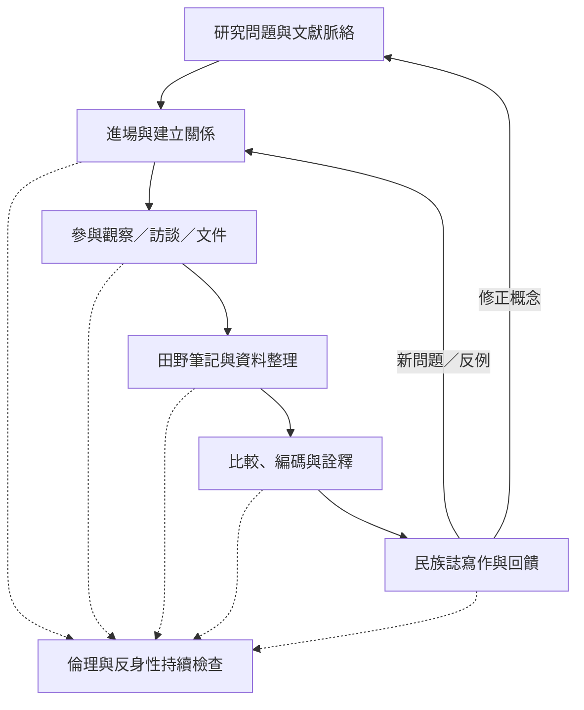

民族誌不是固定的線性程序，而是研究問題、田野關係、資料生成、分析與寫作之間反覆修正的循環。田野中的意外事件可能改變研究問題；分析中的矛盾也可能要求研究者回到場域補充觀察。每一步都必須保留倫理與反身性檢查。

**流程核心**：田野關係不只是資料取得的前置條件；研究者如何進場、參與、被理解與退出，都會影響知識形成。研究品質也不是依照步驟完成就自動獲得，而是透過材料透明度、脈絡化詮釋與倫理責任持續建立。

## 核心概念
* [[Ethnography]]、[[Fieldwork]]、[[Participant_observation]]、[[Fieldnotes]]、[[Thick_description]]。
* [[民族誌是一種透過關係參與持續生成知識的方法]]、[[參與觀察不是旁觀而是帶著角色進入共同生活]]、[[田野筆記是分析材料而不是中性的現場複製品]]。

## 延伸行動
* [[用七天日常觀察練習區分事實描述與文化詮釋]]
* [[把田野筆記轉成原子化永久筆記以累積可重組知識]]
