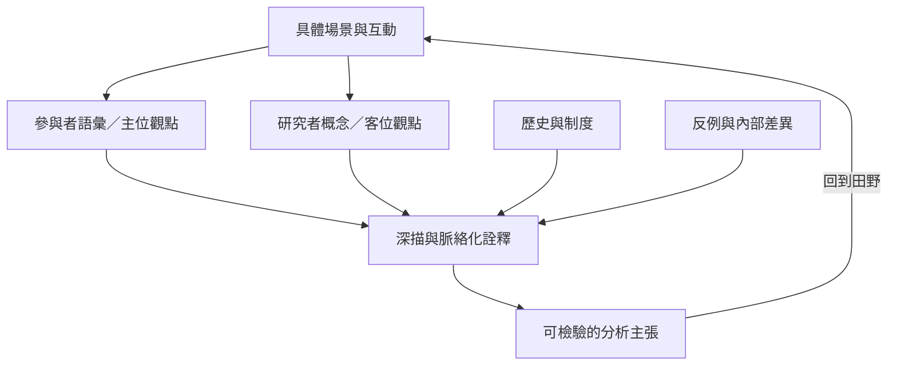

民族誌分析需要在場景細節與更大尺度的制度、歷史及跨地關係間移動。主位觀點幫助研究者理解參與者自己的分類；客位分析提供可比較的概念。深描讓兩者在具體脈絡中相互檢驗，而不是將一方當成另一方的替代品。

**閱讀重點**：深描不是把一則故事當成整體文化的縮影。研究者必須交代詮釋依據、範圍與例外，並辨認文化分類如何在權力關係中被使用與改寫。

## 核心概念
* [[Emic]]、[[Etic]]、[[Thick_description]]、[[Reflexivity]]、[[Positionality]]。
* [[深描必須呈現行動在當地脈絡中的可理解性]]、[[主位觀點需要與分析者的客位觀點對話]]、[[文化不是邊界固定且內部一致的整體]]、[[民族誌的分析要往返於微觀互動與宏觀制度]]。

## 延伸行動
* [[用反例測試民族誌中的文化概括是否過度寬泛]]
* [[以生命史時間線理解個人選擇背後的制度條件]]
