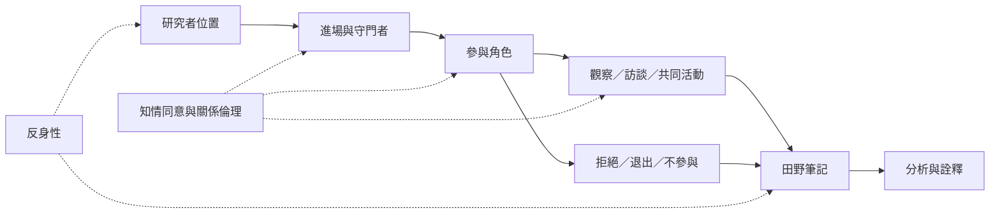

田野不是被動等待研究者進入的資料容器，而是由准入、互信、角色、互惠、拒絕與退出共同形成的關係場域。研究者必須說明自己如何被允許看見某些活動、為何不能參與另一些活動，以及這些條件如何影響研究。

**閱讀重點**：參與觀察、半結構式訪談、生命史與重要報導人不是互斥技術；它們是在關係限制下互補的資料途徑。參與者拒絕、沉默或限制公開，也應被尊重，而不是被當作需要突破的障礙。

## 核心概念
* [[Participant_observation]]、[[Fieldwork]]、[[Fieldnotes]]、[[Key_informant]]、[[Life_history]]、[[Semi_structured_interview]]、[[Informed_consent]]。
* [[民族誌需要把不參與與退出也視為重要的田野資料]]、[[研究倫理是持續協商的關係實踐]]、[[反身性讓研究者檢查自己如何參與資料生成]]。

## 延伸行動
* [[建立研究者位置備忘錄以辨認田野中的權力差距]]
* [[把知情同意拆成不同階段的可撤回協商]]
