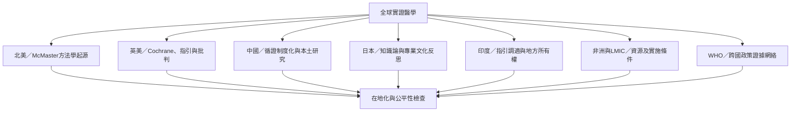

實證醫學在不同地方的發展並非單向複製。加拿大和英美形成重要的方法學基礎；中國的經驗呈現學科引入、研究中心與本土醫療知識互動；日本的社會學反思質疑典範轉移敘事；印度的指引經驗凸顯地方所有權；非洲與低中收入國家的研究則突顯人力、資源、網路、訓練及制度支持。

## 永久筆記
* [[跨國採用指引必須重新檢查適用性公平與可行性]]
* [[證據轉譯需要組織資源與在地協作]]
* [[實證醫學的批判應促進復興而不是拋棄證據]]
* [[研究偏差可能從問題設定一路滲入到發表與指引]]

## 概念
[[實證醫學]]、[[循證實踐]]、[[證據轉譯]]、[[證據到決策框架]]、[[患者與公眾參與]]、[[臨床實務指引]]

## 文獻
[[中國的實證醫學口述史呈現本土化發展與資源挑戰]]、[[中國循證醫學發展顯示研究產出與知識轉譯必須同步前進]]、[[日本的實證醫學反思提醒方法移植必須接受社會脈絡檢驗]]、[[印度治療指引經驗顯示在地適應能增加所有權與臨床接受度]]、[[非洲醫療人員的實證實踐受到訓練資訊與組織支持影響]]、[[低中收入國家的實證健康創新落地最常遭遇資源與情境限制]]、[[WHO的EVIPNet以多方對話將全球研究與地方知識帶入政策]]
