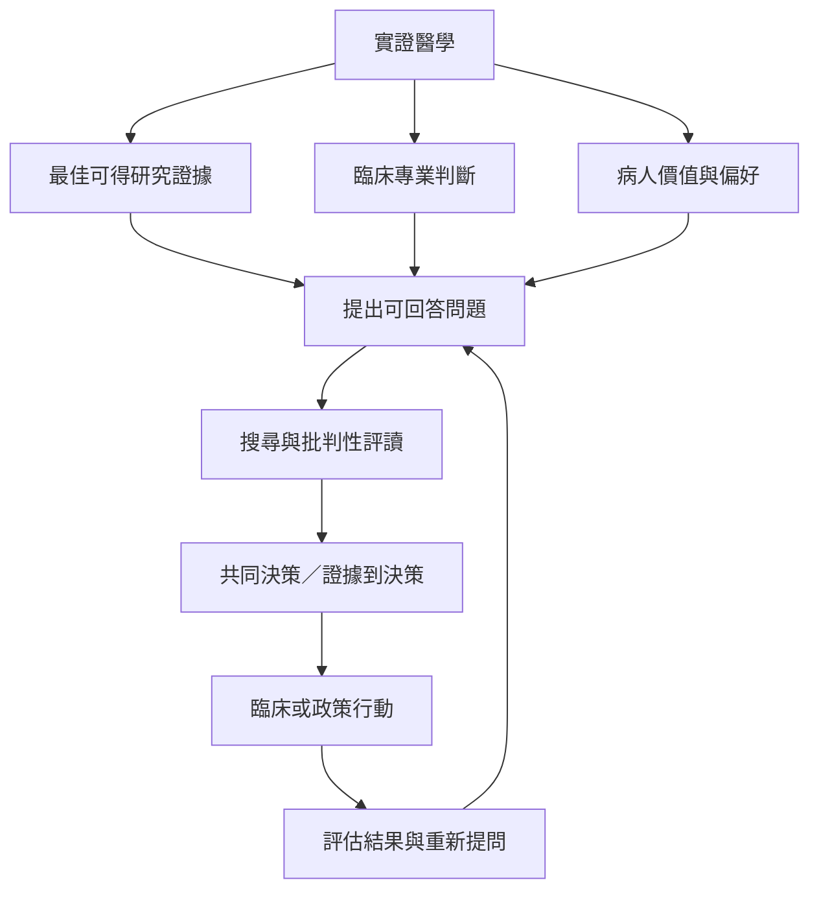

本圖將實證醫學的三個核心來源與實踐循環放在一起。研究證據不是決策終點，而是和專業判斷、病人價值交互作用，再透過臨床或政策行動回到結果評估。

## 深入閱讀
* [[實證醫學必須整合研究證據專業判斷與病人價值]]
* [[實證實踐是一個提出問題搜尋評讀應用與評估的循環]]
* [[實證醫學的形成源自McMaster臨床流行病學與批判性閱讀]]
* [[實證醫學的口述歷史呈現學科形成背後的人與制度]]

## 概念
[[實證醫學]]、[[循證實踐]]、[[臨床流行病學]]、[[最佳可得研究證據]]、[[臨床專業判斷]]、[[病人價值與偏好]]、[[PICO問題架構]]、[[5A實證實踐流程]]

## 研究與資源
[[實證醫學的經典定義要求整合研究證據專業判斷與病人處境]]、[[使用者醫學文獻指南提供從研究閱讀走向臨床應用的完整教材]]、[[如何閱讀論文必須同時理解方法學統計與適用情境]]、[[治療試驗一書將公平研究與患者參與帶入公共討論]]
