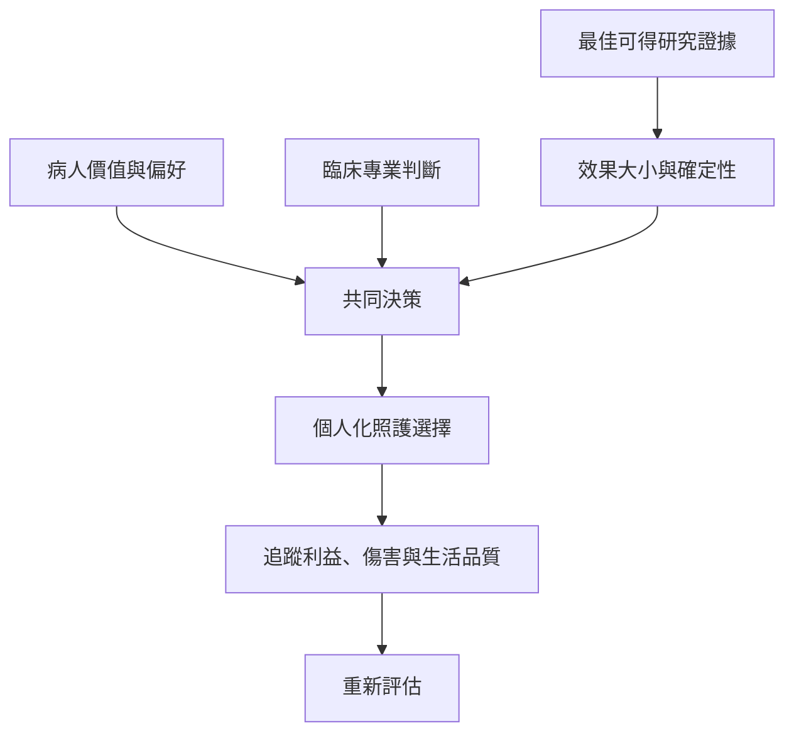

證據的價值在於改善真實照護，而不是停留在論文或指引。從研究走向個人選擇，需要理解絕對風險、病人價值與偏好、專業判斷以及決策的倫理與情境。

## 永久筆記
* [[實證醫學必須整合研究證據專業判斷與病人價值]]
* [[統合分析的平均效果必須轉譯為病人的絕對風險]]
* [[臨床指引應支援判斷而不是取代病人的選擇]]
* [[病人參與能重新定義什麼研究問題值得回答]]

## 概念
[[共同決策]]、[[病人價值與偏好]]、[[臨床專業判斷]]、[[臨床實務指引]]、[[治療必要人數]]、[[相對風險與絕對風險]]、[[證據到決策框架]]

## 文獻
[[實證醫學的批判應推動以病人為中心的復興而非否定證據]]、[[治療試驗一書將公平研究與患者參與帶入公共討論]]、[[患者與公眾參與能讓研究回應生活中真正重要的問題]]
