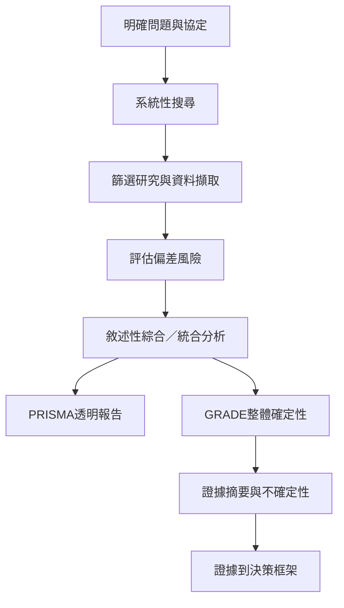

系統性回顧把分散研究整理成可評讀的證據全貌；GRADE 再對每個重要結果的整體確定性進行判斷。流程圖強調，報告完整性、研究方法品質與證據確定性是相互關聯但不同的問題。

## 永久筆記
* [[系統性回顧的可信度取決於方法而不是名稱]]
* [[統合分析的平均效果必須轉譯為病人的絕對風險]]
* [[GRADE評估的是每個重要結果的整體證據確定性]]
* [[證據的確定性與建議的強度是兩個不同的判斷]]

## 概念
[[系統性回顧]]、[[統合分析]]、[[GRADE方法]]、[[研究偏差]]、[[發表偏差]]、[[相對風險與絕對風險]]、[[治療必要人數]]

## 文獻
[[Cochrane手冊提供介入措施系統性回顧的透明方法規範]]、[[PRISMA 2020讓系統性回顧的報告更透明完整且可檢查]]、[[GRADE方法把整體證據確定性與推薦決策分開評估]]、[[核心GRADE原則指出強建議需要整合確定性與重要價值判斷]]
